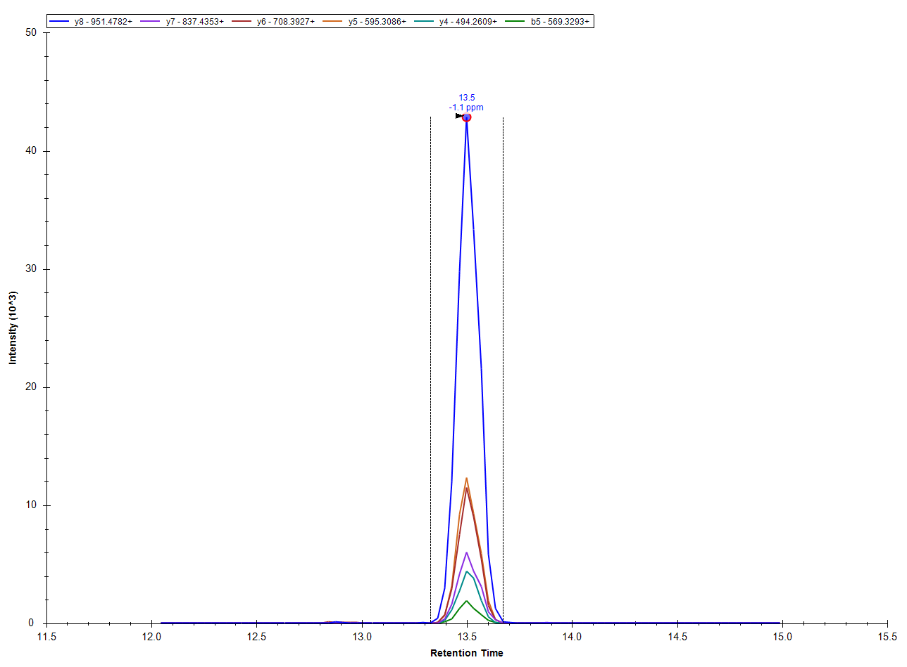
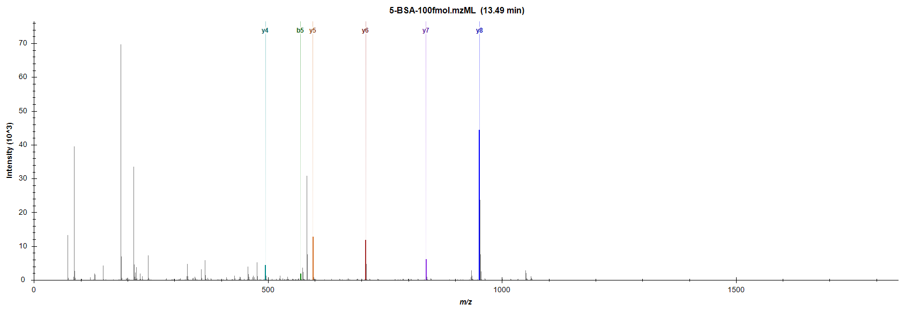
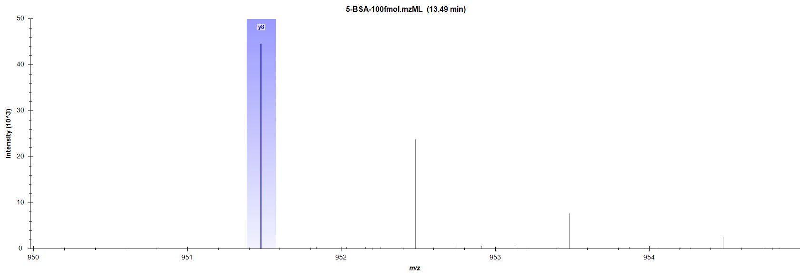
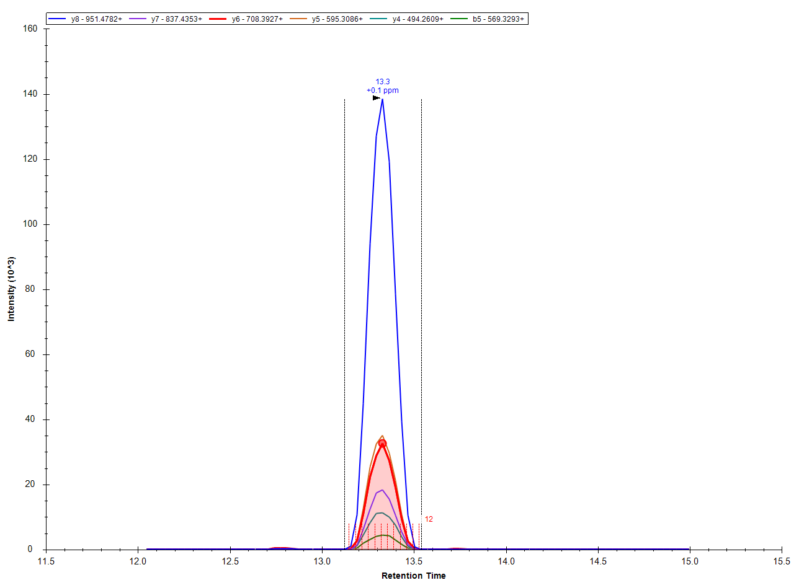
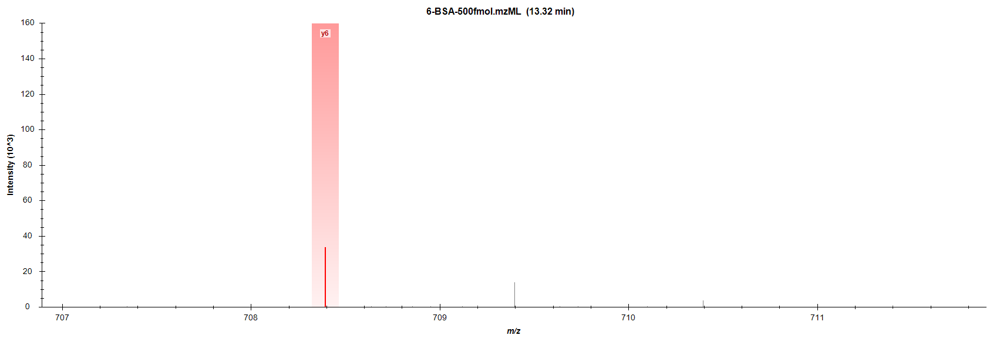

# skyline_show_full_scan (ProteoWizard/pwiz#5031)

Driven over MCP against a Release build. Data: TargetedMSMSMzml tutorial, TOF PRM mzML, peptide LVNELTEFAK.
Images are `skyline_get_graph_image` captures.

## 1. Default: `skyline_show_full_scan(retentionTime: 13.5)`

Selection circle on y8, the most intense transition at 13.5 min:

Full-Scan graph not zoomed:

## 2. Then clicking Zoom to Selection zooms to y8

## 3. With a transition: `skyline_show_full_scan(13.33, replicateName: "6-BSA-500fmol", transitionLocator: ".../y6+")`

Replicate 6-BSA-500fmol is activated, y6 is selected, and the circle is on y6:

Full-Scan graph zoomed to y6:

